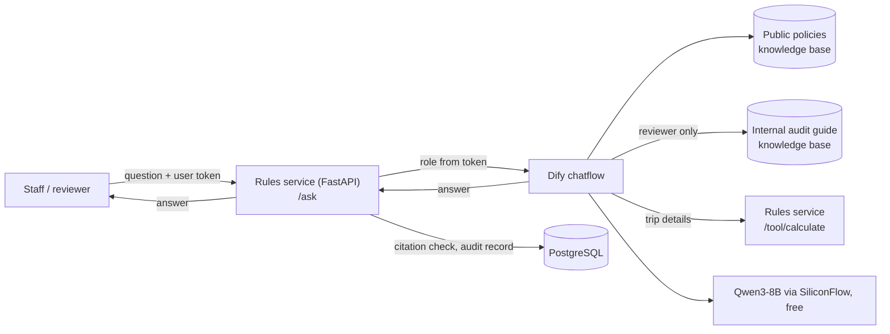

# School AI Assistant

LLM applications for a vocational college, built on a self-hosted [Dify](https://github.com/langgenius/dify)
plus a small Python service that does what an LLM should not be trusted with: arithmetic,
version rules, access control and record keeping. It runs entirely on free model APIs
(SiliconFlow `Qwen/Qwen3-8B`, `bge-m3`, `bge-reranker-v2-m3`).

The main application answers staff questions about travel reimbursement policy. Two lighter
apps on the same Dify instance cover teaching (course Q&A) and research (paper summaries).

> All policies, course notes and paper data in this repository are fictional and labelled as such.
> The assistant is advisory only: it never approves or rejects a claim.

## What it does

A staff member asks: "2026年8月30日到9月2日去广州出差，住了三晚，每晚540元，一共能报多少？"

1. Dify retrieves the relevant clauses from both versions of the travel policy.
2. A parameter extractor pulls out city, dates and hotel prices.
3. Dify calls the rules service, which calculates each day under the policy version in force
   on that day (the trip crosses the 2026-09-01 revision) and notices the 20-day claim
   deadline has passed.
4. The LLM writes the conclusion and cites clauses such as 〔FIN-TRAVEL v2 第13条〕; the
   calculation table is rendered by code and appended, so no amount passes through the LLM.
5. The service checks that every cited clause exists, that a staff user did not receive
   reviewer-only content, and that the conclusion's total matches the computed total
   (correcting it if not), then writes the exchange to the audit log.

## Architecture



| Component | Responsibility |
|---|---|
| Dify (self-hosted, Docker) | Retrieval (bge-m3 + reranker, hybrid search), workflow, LLM prompting |
| `service/app/rules.py` | Both policy versions as data: limits, allowances, effective dates, clause numbers |
| `service/app/calculator.py` | Deterministic calculation, per-day version selection, deadline check, policy gaps |
| `service/app/citations.py` | Rejects citations to clauses that do not exist and reviewer-only citations for staff |
| `service/app/main.py` | `/ask` (role from token, conclusion-total check), `/tool/calculate`, `/feedback` |
| `service/app/db.py` | Users, audit log, feedback in PostgreSQL |

## Results

39-question test set: answerable questions, version traps, calculations, questions the policy
does not cover, access control and misleading questions. Details in [eval/README.md](eval/README.md).

| Setup | Model cost | After manual review | Median latency |
|---|---|---|---|
| Dify only | paid (DeepSeek) | 37/39 | – |
| Dify + rules service | paid (DeepSeek) | 39/39 | 19 s |
| Dify + rules service, model copies numbers | free (Qwen3-8B) | 29/39 on automatic checks | 36 s |
| **Current: + code-rendered amounts, total check, domestic-only rule** | **free (Qwen3-8B)** | **36/39, 2 debatable, 1 fail** | **36 s** |

What moving to the free 8B model showed: it miscopied and invented numbers, so amounts were
moved entirely into code (calculations 3/7 → 7/7 on automatic checks). It also invented a
domestic hotel rate for an overseas trip until an explicit domestic-only rule was added.
Remaining weaknesses are wording, not numbers: one misleading conclusion (M01) and two
answers that infer instead of flagging a policy gap. Limits: one run per configuration
(small-model output varies between runs), and the test set was written by the builder.

## Run it

Requirements: Docker, about 20 GB of free disk, and a SiliconFlow API key (only free models are used).

1. Deploy Dify 1.17.1 with Docker Compose and add the two model providers
   ([docs/deployment-notes.md](docs/deployment-notes.md) lists the problems hit and their fixes).
2. Create the knowledge bases from `data/` and import the apps from `dify/` ([dify/README.md](dify/README.md)).
3. In Dify's `docker/.env`, set `SSRF_PROXY_ALLOW_PRIVATE_DOMAINS=reimburse-service`.
4. Here: `cp .env.example .env`, fill it in, then

   ```bash
   docker compose up -d --build
   docker compose exec -T service uv run --no-dev python seed_users.py >> .env
   ```

5. Tests and evaluation:

   ```bash
   cd service && uv run pytest            # 28 unit tests, no database needed
   cd .. && python eval/run_eval.py --label run1 --target service
   ```

## Repository

```
docs/requirements.md      requirements written as if for the finance office
docs/deployment-notes.md  setup and every deployment problem with its fix
docs/demo-script.md       5-minute demo with commands and likely interview questions
docs/lesson-plan.md       4-hour student lab: building a course Q&A assistant in Dify
data/                     fictional policies, course notes, abstract
dify/                     exported Dify apps (secrets blank)
service/                  FastAPI rules service + tests
eval/                     test set, runner, results
```

## Licence note

Dify is used unmodified under its [open-source licence](https://github.com/langgenius/dify/blob/main/LICENSE)
(Apache 2.0 with additional conditions). This repository contains only exported app
definitions for it, not Dify code.
